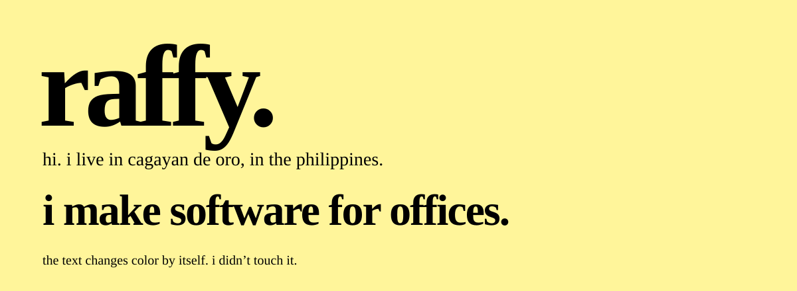
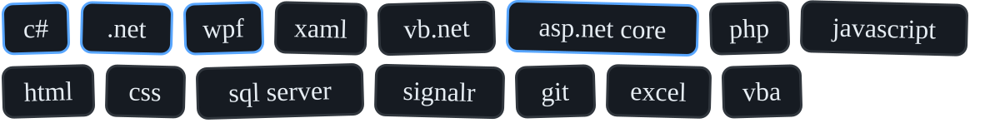

the kind of software where, if it works, nobody notices. which is the goal. it's a weird goal.

web apps. desktop apps. the stuff in between. mostly c# and .net, some php.

- **a timesheet website.** it works out who worked overnight. overnight is hard, because the date changes in the middle.
- **a desktop program** that reads attendance from biometric devices and turns it into something a person can use.
- **a page that says whether outlook, teams, the email servers and our own servers are up or down.** up or down. that's the whole page.
- **a tracker** that notices which websites get visited, and a dashboard to look at them. i'm not going to say which sites.
- **a chat and announcements site,** for one company, private.
- **an app where everyone's screen updates at the same time.** spooky.
- **a program that fills in the excel reports** so people don't have to. excel did not ask for this.
- **a front door.** one address, and it sends you to the right internal website. like a receptionist, but a program.
- **the first big one:** a school website where students ask for documents, like transcripts. it made things about 40% faster, reportedly. i put the word "reportedly" there on purpose.

a lot of these are internal company systems, so i'm keeping the details vague.

| when | what happened |
|---|---|
| **december 2023** | i start making a website for a school. phinma cagayan de oro college. php. |
| **october 2024** | i finish. it works. |
| **january 2025** | i start making software for a company. internal stuff. c#, .net. |
| **now** | still going. |

there's more on my [portfolio](https://raffy-off-port.vercel.app/). the stuff i left out here is mostly in there.

[email me](mailto:macaindig.ma@gmail.com)

one more thing

there is no more thing. i lied.

drink some water.

