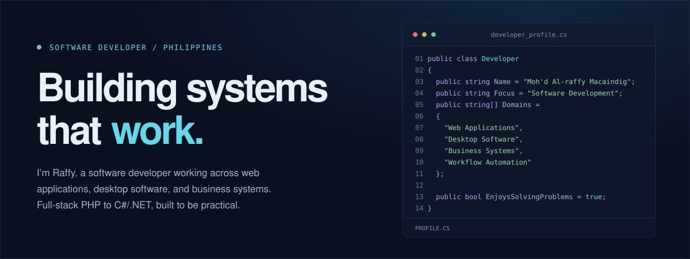

  
  
  
  
  
  

🔎 <b>Open to junior .NET and WPF developer roles</b>

---

## About me.

I'm a software developer who builds practical software for business operations. I started in PHP and web development, and now work mostly in the .NET ecosystem. I enjoy the whole process: understanding what people need, building it, and improving it once it's in use.

## What I work on.

- **Web applications:** Full-stack and internal systems in ASP.NET Core
- **Desktop software:** C# and WPF apps for everyday business tasks
- **Business systems:** Attendance, monitoring, reporting and internal platforms
- **Workflow automation:** Removing manual work from Excel- and Word-based processes

[**View my portfolio ↗**](https://raffy-off-port.vercel.app/) · [Get in touch ↗](mailto:macaindig.ma@gmail.com)
